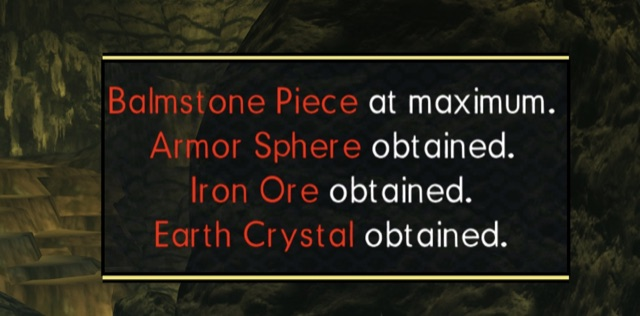
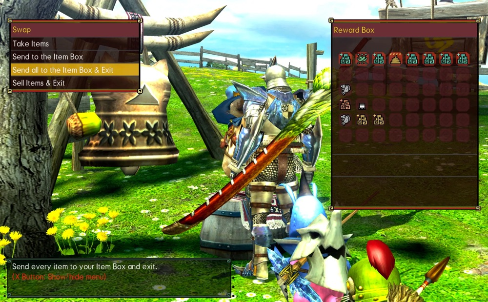
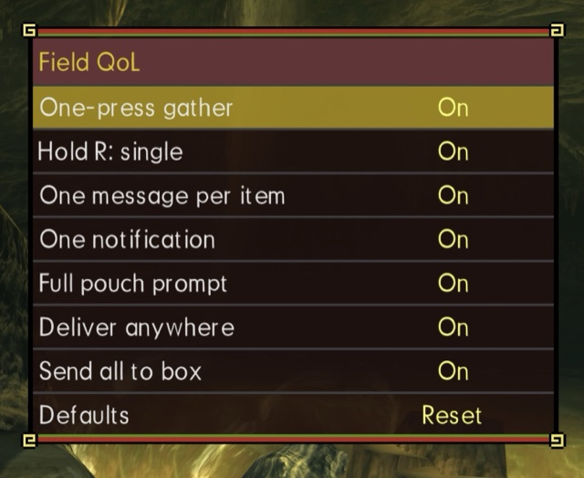

# Field QoL

Quality-of-life changes for quests in **Monster Hunter Generations Ultimate**, as a Forge plugin for
[MHGU Recomp](https://github.com/morerokk/MHGURecomp).

> Only tested on MHGU Recomp (macOS), with the English game text. It has not been tested on a Switch or an emulator.

## Features

**Gather a whole spot with one press.** At a mining, bone, bug, herb or mushroom spot, one press gathers everything
the spot has left. Carving works the same way: one press takes all of a carcass's carves. Each item gets its own roll
as usual, and skills and early breaks work the same. It stops:

- before eggs, powderstone and other items you carry in your hands: those still take a press each;
- when you carve Gypceros while it plays dead: you get one carve, as usual, before it gets up.

Hold **R** as you start gathering to gather a single item instead, for spots like Khezu Welps where you can only
carry one and gathering everything would use up every chance.

A full pouch doesn't stop it: every gather is still rolled, and the pouch takes what fits (items you already have
stack as usual). Items at their stack limit are lost, as in the game. For items that need a free slot, the game's
"Item Pouch is full" window opens once the spot is done, one item after the other, so you choose what to replace in
one go instead of after every press.

All of a spot's messages come in one notification, with one line per item (and its total when you gathered several,
`Iron Ore x3`). A spot with more than 6 lines continues in a second notification.

<p align="center"></p>

**Deliver from anywhere.** The Item Pouch's **Deliver** and **Clear out Account Items** work anywhere on the map, not
only in the base camp. Which items can be delivered doesn't change: the quest's target items and account items, but
not carried items such as eggs.

**Send all to the Item Box & Exit.** The quest reward screen gets a new menu row under "Send to the Item Box". It
sends every item of the section to your Item Box and moves on to the next section. The same row is on:

- the reward box and your Palicoes' gathered items;
- the rewards from Meownster Hunters and Hunters for Hire;
- the Item Appraisal, as "Send all to Boxes & Exit": items go to the Item Box, appraised equipment and charms to the
  Equipment Box;
- the trade cart's Claim Items: it sends all three carts' items to the Item Box and closes Claim Items;
- the Melding Pot's Meld Result, as "Send all to Item Box & Exit": every melded Talisman goes to the Item Box and Meld
  Result closes.

If the box fills up first, the menu stays open with what's left. The row has its own help line, and the game's own
rows keep theirs.

<p align="center"></p>

**Meld leftovers.** On the Melding Pot's talisman list (choose a melding, then "Select 3 Talismans"), **Y** chooses
the talismans you don't need for you: those another talisman of yours beats or equals (at least the points in every
skill either one has, negative skills too, and at least the slots; of identical talismans one is kept). It never
chooses the talisman you wear or one in a saved equipment set, and takes the least valuable first. If there aren't
enough, it chooses what there is, a notification says how many it found, and the rest is up to you. The guide at the
bottom right shows "Select Leftovers".

**Sell all leftovers.** In **Item Box > Manage Equipment > View Talismans**, keep **R** (the game's sell button)
held, then press **ZL**: it sells every leftover Talisman at once, the same ones Meld leftovers would choose, never the
one you wear, one in a saved equipment set or one with Decorations attached. Pressing ZL first does nothing: R has to
be held down when ZL is pressed. The game's sale question first shows how many it sells and their total in zenny; No
sells nothing. R on its own still sells the Talisman under the cursor, when you let go of it. The guide at the bottom
right shows "Sell (ZL: Leftovers)".

**Auto-sort the Item Pouch** (off by default). Whenever items are added to the Item Pouch (gathering, carving,
rewards, the supply box, the Item Box), it's sorted the way its own Sort does it (the top face button in the pouch),
without the question and the sound. While a box screen is open, the sort waits until you close it. Sorting by hand
still asks as usual.

**Melding jackpot** (off by default). Every melding gives 7 charms, the most an order can hold:

| Melding | The game gives | With the jackpot |
| --- | --- | --- |
| Mystery, Luminous, Ancient, Fabled | 1 Mystery, Shining, Timeworn or Enduring Charm | 7 of that charm |
| Halcyon | 0 to 7 charms of random types | 7 charms, each type rolled with the game's odds |
| Juju | 0 to 2 Enduring and 1 to 2 Timeworn Charms | 5 Enduring and 2 Timeworn Charms |

For Juju Melding this is what the cheat `04000000 00196A9C E3A0A007` / `04000000 00196AA0 E3A09005` does.

## Settings

Every feature can be turned on and off. They're all on by default, except Auto-sort and the Melding jackpot.
With [Purple-lib](https://gamebanana.com/mods/740376) (r19 or later, optional) open the start menu, then
**Options > Mod Options > Field QoL**. Without it, press **Insert** in game for Forge's menu and open **Field QoL**. The switches are saved when you change them, in `save_0/fieldqol.ini` next
to your save, so they stay as you set them the next time you start the game. You can edit that file while the game is
closed.

<p align="center"> Mod Options"></p>

## Install

1. Download `field-qol-<version>.zip` from [Releases](../../releases).
2. Extract it into the recomp's `mods` folder, so that you get `mods/field-qol/`:
   - macOS: `~/Library/Application Support/MHGURecomp/mods/`
   - Windows and Linux: the `mods` folder next to the recomp's executable
3. Start the game. `log.txt` should list three `field-qol:` lines: `one press gathers the whole spot`,
   `pouch deliveries work anywhere` and `Send all to the Item Box & Exit on the reward screen`.

Nothing else is needed: no layout tool and no game files. The new menu rows are made by the plugin while the game
runs.

**Updating from 0.5 to 0.7:** those versions needed a layout tool, which wrote `.arc` files into the mod's folder.
They aren't needed anymore: delete `field-qol/romfs/nativeNX/eng/arc/` (with `result_eng.arc`,
`village/common_eng.arc` and `facility/shoptrade_eng.arc` in it) and the old `field-qol/tools/` folder.

## Uninstall

Delete the `field-qol` folder, or turn the mod off in the recomp's Mods tab. The mod never changes your game files.
Your settings stay in `save_0/fieldqol.ini` next to your save; delete that file too if you want them gone.

To keep the other features but get the game's original menus back, turn off **Send all to box** in the settings.

## Compatibility

- **Game version:** MHGU 1.4.0, which the recomp needs anyway.
- **Language:** only tested with the English game text. The plugin's own texts (the new rows, their help lines and the
  settings) are in English.
- **Other mods:** the mod ships no game files, so it doesn't replace anything another mod changes.

## Building

You need an `arm-none-eabi` GCC toolchain (on macOS: `brew install arm-none-eabi-gcc`) and Python 3.

```sh
sh build.sh            # builds out/field_qol.nro
sh build.sh install    # builds and installs into the recomp's mods/field-qol/
sh build.sh release    # builds dist/field-qol-<version>.zip
```

`install` uses macOS's default recomp folder, `~/Library/Application Support/MHGURecomp`: set `RECOMP=<path>` for
another.

### Layout of the repository

| Path | What it is |
| --- | --- |
| `src/plugin.c` | The plugin: game addresses, hooks, and how each feature works |
| `src/forge.h` | The part of Forge's plugin API the plugin uses |
| `src/purplelib.h` | Purple-lib's plugin header, for the Mod Options page |
| `src/start.S`, `build/` | NRO start code, linker script and ELF to NRO converter |
| `docs/` | The screenshots in this readme |
| `release/README.txt` | The readme that goes in the release zip |

## Credits

- `src/start.S`, `build/nro.ld` and `build/elf2nro.py` come from lick-mee's
  [mhgu-gathering-map](https://github.com/lick-mee/mhgu-gathering-map) (MIT).
- `src/purplelib.h` is the header of [Purple-lib](https://gamebanana.com/mods/740376) by PurplefinNeptuna (MIT).
- The plugin API is [Forge](https://github.com/Fexty12573/forge) by Fexty12573.

## License

[MIT](LICENSE).
